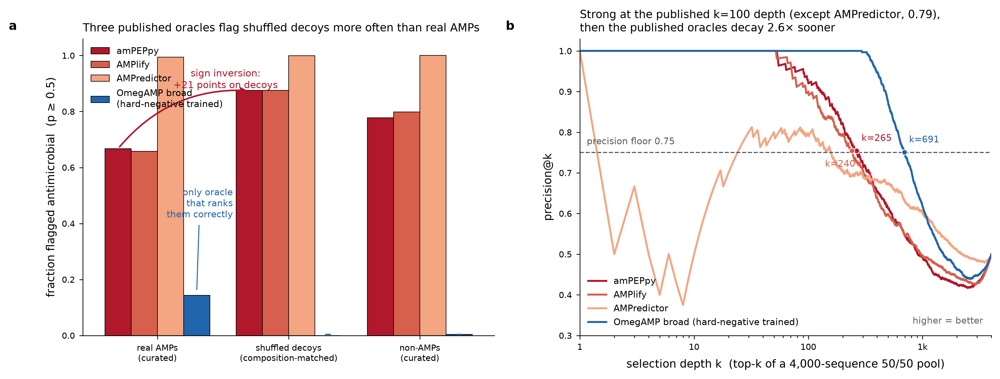

# Oracle Audit — the benchmark that scores shuffled decoys above real antimicrobial peptides

**OSI Hackathon 2026 · bucket: Hypothesis Generation and Evaluation · solo team**
Code: https://github.com/Rebell-Leader/oracle-audit · Live app: http://sciway.me/oracle-audit/ ·
Dataset: https://huggingface.co/datasets/avaliev/oracle-audit-amp-scores

## Motivation
Generative design of antimicrobial peptides (AMPs) is evaluated almost entirely by *in-silico oracles* —
published AMP classifiers standing in for a wet-lab MIC assay. Leaderboards, competition rankings and
"novel AMP discovered" claims rest on them. Nobody audits the oracle.

## Problem definition
We ran the simplest possible validity check on 16 oracles from two methodological families, over 9
cohorts totalling 14,977 peptides: take 2,000 real curated AMPs, shuffle each one (same amino-acid
composition, order destroyed), and ask whether the oracle still separates real from shuffled.

## What we found
**The two families disagree in sign.** At p >= 0.5, amPEPpy flags 87.5% of shuffled decoys and 77.8% of
curated non-AMPs but only 66.8% of real AMPs; AMPlify 87.6 / 79.8 / 65.8. They rank decoys *above* the
real thing. OmegAMP's hard-negative-trained classifier orders the same cohorts correctly: 0.0% / 0.3% /
14.4%. Across all 16 oracles, 3 of 3 Family-B oracles are sign-inverted and 13 of 13 Family-A are not.
A useful control: ProtGPT2 samples are rejected by both families, so Family B is not simply permissive —
it is specifically blind to composition-preserving shuffles.

**Selection depth explains why this survived review.** At the published precision@100 depth the oracles
look comparable (0.92 amPEPpy, 0.90 AMPlify, 1.00 OmegAMP broad; AMPredictor 0.79). Precision falls
below 0.75 at k = 265 and k = 240 for the published oracles, versus k = 691 — a 2.6x gap in usable depth,
invisible at the reported depth. Real campaigns select far deeper: one pipeline we examined took the top
50,000 of 998,452 candidates ranked by amPEPpy + AMPredictor.

**The field does not run this check.** Via the Valency Bond connector: of 30 screened papers that
generate and evaluate AMPs in silico, 0 report any composition-preserving decoy control; of the 5
most-cited whose methods we read, every third-party oracle applied belongs to the inverted family.

## What we built (all released)
1. `oracle_audit.py` — a **sign test** and a **depth test** that run against any scorer, as a module and CLI.
2. The **audit dataset** — per-peptide scores, 14,977 sequences x 16 oracles x 9 cohorts, with a data card.
3. An **interactive marimo notebook** (WASM, no login, no server): pick an oracle, move the threshold,
   watch the verdict and depth curve recompute live.

## Recommendation
Filter deep with hard-negative-trained classifiers; use published oracles only as a shallow final
re-rank; always hold out one oracle per family as a cross-family control and report a
shuffled-decoy cohort. Benchmarks now being designed for generative peptide discovery can adopt this in
an afternoon — the audit is 40 lines of code against any scorer.
